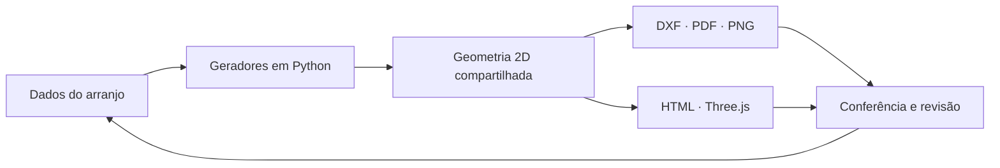

# Geração programática de documentação CAD e visualização 3D

Estudo de caso anonimizado sobre automação aplicada à documentação de um painel de automação industrial.

**[Abrir o estudo de caso](index.html)** · **[Baixar o dossiê visual em PDF](assets/portfolio_diagramas.pdf)**

## O projeto

O trabalho desenvolve geradores em Python para produzir desenhos CAD a partir de uma definição estruturada do arranjo. Um segundo gerador reaproveita esse layout para criar uma visualização tridimensional interativa, executada localmente no navegador com Three.js.

O conjunto de engenharia inclui desenhos de arranjo e detalhes, diagramas de interligação, arquitetura de automação, memorial e listas técnicas. O repositório descreve o processo em nível de portfólio; não distribui arquivos do cliente.

## Fluxo técnico



## Limites e atribuição

- O autor relata uso de IA como apoio ao desenvolvimento e à iteração das ferramentas. Os arquivos comprovam os geradores, mas não incluem histórico de prompts.
- A IA não é apresentada como responsável pela geração automática dos desenhos. Os artefatos são produzidos pelos scripts CAD.
- A revisão local do projeto ainda registra itens pendentes de regeneração e conferência. O material não é declarado aprovado para fabricação nem como levantamento “as built”.
- Nomes, identificadores, tags, dimensões, folhas, fornecedores, documentos de origem e imagens do cliente foram omitidos por confidencialidade e restrição de uso indicada nos desenhos-fonte.

## Laboratório demonstrativo

A pasta [`demonstracao-sintetica/`](demonstracao-sintetica/) contém um protótipo independente com configuração fictícia. Ele permite experimentar geração determinística de SVG e DXF e serve para demonstrar o conceito de dados estruturados. Não é o software do projeto original, não chama um modelo de IA e não deve ser confundido com as entregas de engenharia descritas neste estudo de caso.

```powershell
cd demonstracao-sintetica
python server.py
```

Abra `http://127.0.0.1:8765`. O protótipo usa somente a biblioteca padrão do Python.

## Estado do estudo

Material preparado para portfólio e GitHub. Não constitui aprovação técnica, autorização de fabricação nem postagem em rede social.
