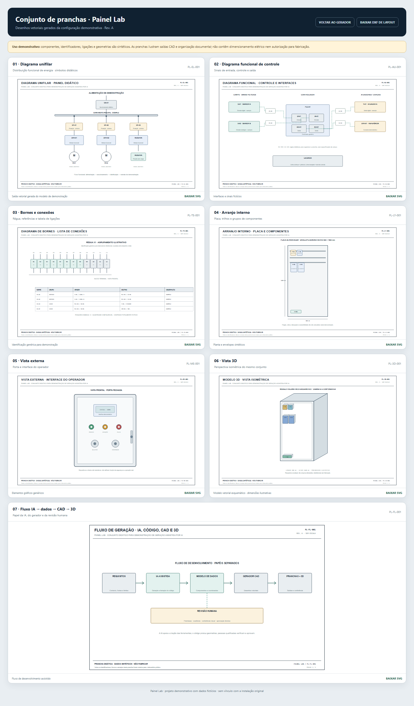

# Painel Lab — AI-assisted CAD and 3D panel generator

A local prototype about an AI-assisted engineering workflow. One structured, fictional panel model produces a 2D layout, an isometric view, an editable R12 DXF, and a seven-sheet drawing set.



[Open the seven-sheet A3 PDF](assets/portfolio_diagramas.pdf)

## The drawing set

1. Single-line power diagram
2. Functional control and interface diagram
3. Terminal strip and connection schedule
4. Internal mounting layout
5. External operator interface
6. Isometric 3D view
7. AI → data → CAD → 3D workflow

All identifiers, components, circuits, and dimensions are invented examples. The drawings demonstrate how structured data can drive multiple outputs; they are not an electrical design for construction.

## Run locally

Requires Python 3.10 or later. No third-party Python packages are required.

```powershell
python server.py
```

Open `http://127.0.0.1:8765`. The server binds to `127.0.0.1` only. Stop it with `Ctrl+C`.

## Workflow

1. Enter a short demo brief or change the synthetic parameters.
2. Interpret the brief with the local demonstration parser.
3. Generate a shared layout model.
4. Inspect 2D, 3D, and the seven vector sheets.
5. Download JSON, SVG, and DXF artifacts.

The brief parser uses local patterns; it does not call an LLM. The source engineering project used AI during development of its generators, as reported by the author; Python/CAD scripts produce its engineering outputs. This public prototype demonstrates that generation stage with entirely synthetic data.

## Technical notes

- `generator.py`: validates inputs and builds layout JSON, SVG, and ASCII DXF R12.
- `drawings.py`: generates the seven SVG engineering sheets from the shared configuration.
- `server.py`: standard-library localhost server and JSON API.
- `index.html` and `sheets.html`: generator interface and drawing gallery.
- `samples/`: generated examples and the complete synthetic drawing set.
- `tests/`: standard-library unit tests.

## Tests and validation

```powershell
python -m unittest discover -s tests -v
```

The five unit tests cover input constraints, output generation, and XML validity of all seven SVG sheets. The generated DXF is R12 and opens with `ezdxf`.

## Scope and rights

This repository does not contain client drawings, tags, dimensions, vendor documents, or operational details. The sample layout is not reviewed for cable sizing, protection, heat, safety, code compliance, or manufacturing readiness. Do not use it to build equipment. Confirm authorship and rights before reusing any external asset.

Public repository: https://github.com/gustavorioshonorato/painel-lab-ai-cad-3d
