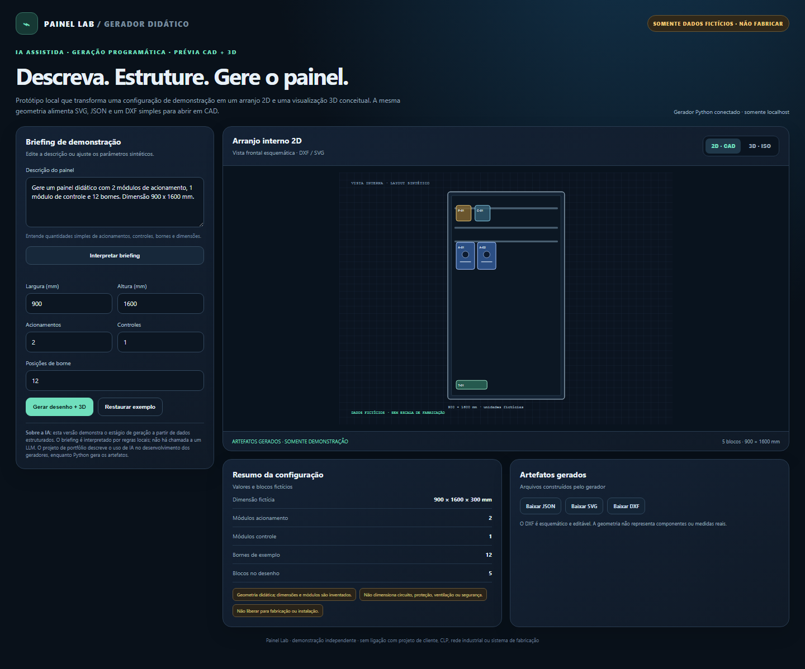
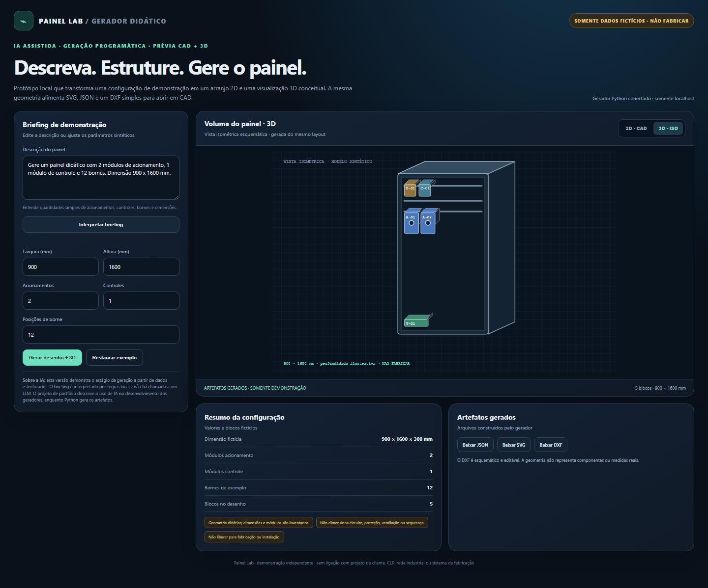

# Painel Lab — AI-assisted CAD and 3D panel generator

A small local prototype demonstrating how one structured, fictional panel layout can drive a 2D SVG view, an isometric 3D view, and an editable R12 DXF file.





## Run locally

Requires Python 3.10 or later. No third-party Python packages are needed.

```powershell
python server.py
```

Open `http://127.0.0.1:8765`. The server binds to `127.0.0.1` only. Stop it with `Ctrl+C`.

## Workflow

1. Enter a short demo brief or change the synthetic parameters.
2. Interpret the brief with the local demonstration parser.
3. Generate a shared layout model.
4. Inspect 2D and isometric views.
5. Download JSON, SVG, and DXF artifacts.

The browser's brief parser uses simple local patterns; it does not call an LLM. This prototype focuses on the programmatic generation stage. The source engineering project used AI during development of its generators, as reported by the author; Python/CAD scripts produce the drawings and 3D visualization.

## Technical notes

- `generator.py`: validates parameters and builds layout JSON, SVG, and an ASCII DXF R12 file.
- `server.py`: standard-library localhost server and JSON API.
- `index.html`: responsive UI with the briefing parser and 2D/3D previews.
- `samples/`: generated synthetic example files.
- `tests/`: standard-library unit tests.

## Scope and safety

All IDs, components, sizes, and layouts in this repository are fictional. The sample DXF is an editable geometry demo, not an electrical design. Nothing here calculates cable sizes, protection, heat, safety functions, code compliance, or manufacturing readiness. Do not use it to build or install equipment.

No source client drawings, tags, dimensions, vendor documents, or operational details are included. This repository has not been published. Confirm authorship and permission for every asset before public release; add a license only after rights are clear.
